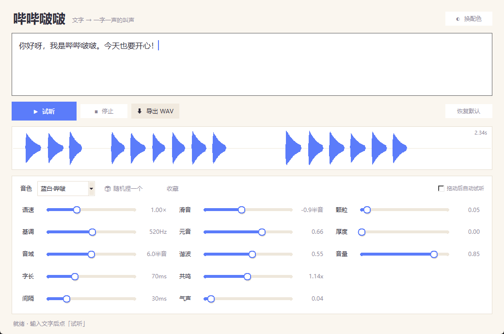

# 哔哔啵啵 · 文字转叫声

> 输入一段文字，它变成一字一声的「哔哔啵啵」——动物森友会那种。
> 纯本地运行，不联网、不录音、不上传。



## 这是什么

一个把文字变成可爱叫声的小工具。每个字对应一声哔啵，音高、长短、口型都可以调。
捏好的音色能收藏、能导出 WAV，用来做桌宠配音、游戏音效、视频素材。

- **一字一声**：字数决定时长，节奏跟着原文走
- **十三根滑条**：基调、音域、语速、字长、滑音、元音、谐波、共鸣、气声、颗粒、厚度……
- **七个预设**：蓝白哔啵、小黄鸭、电子宠物、老机器人、耳语小幽灵……
- **随机捏音色**：手气不好时点一下，经常能出怪东西
- **导出 WAV**：44100Hz / 16bit / 单声道，剪映、PR、QQ 都能直接用
- **命令行**：不想开界面就 `python bleep.py "文字" -o out.wav`

## 快速开始

需要 Python 3.9+ 和 numpy。

```bash
pip install numpy
python bleep_gui.py
```

Windows 用户直接双击 `启动.bat`。

### 命令行

```bash
python bleep.py "你好呀，今天也要开心！" -o hello.wav
python bleep.py "嘎嘎嘎" -p 小黄鸭 -o duck.wav
python bleep.py --list                        # 看所有预设
python bleep.py "随便说点什么" --random --seed 7
```

### 当库用

```python
import bleep

voice = bleep.PRESETS["蓝白·哔啵"]
u = bleep.render("你好呀", voice)
bleep.write_wav("a.wav", u.audio)
print(u.duration, len(u.events))   # 每个字的起止时间都在 u.events 里
```

`u.events` 每项带 `pos`（原文下标）、`t`（起始秒）、`dur`、`f0`，
做「说到哪个字高亮哪个字」直接拿去用。

## 试听

`示例/` 里有 7 个已经生成好的 WAV，双击就能听：

| 文件 | 音色 |
| --- | --- |
| `01_蓝白_打招呼.wav` | 蓝白·哔啵（默认，偏亮偏脆） |
| `02_黑白_打招呼.wav` | 黑白·哔啵（低一点、稳一点） |
| `03_小黄鸭.wav` | 小黄鸭（音高跳得厉害，很皮） |
| `04_电子宠物.wav` | 电子宠物（方波味，复古 8-bit） |
| `05_老机器人.wav` | 老机器人（低、慢、有点闷） |
| `06_耳语小幽灵.wav` | 耳语小幽灵（气声多，像耳边说话） |
| `07_随机音色.wav` | 随机捏出来的一个音色 |

## 每根滑条干嘛的

| 滑条 | 效果 |
| --- | --- |
| 语速 | 整句快慢。2.0× 像机关枪，0.5× 慢悠悠 |
| 基调 | 整体音高。600Hz 以上像小动物，300Hz 左右像大只的 |
| 音域 | 字与字之间音高跳动幅度。0 = 平板，8 以上 = 活蹦乱跳 |
| 字长 | 一声持续多久。短 = 电子味，长 = 黏糊糊 |
| 间隔 | 字与字之间的空隙 |
| 滑音 | 一声之内音高往哪滑。负数往下掉（更可爱） |
| 元音 | 0 = 纯电子音；1 = 有明显 a/e/i/o/u 口型 |
| 谐波 | 0 接近纯正弦、圆润；1 很方很复古 |
| 共鸣 | 共振峰高低。>1 更小只更脆，<1 更闷更厚 |
| 气声 | 噪声比例。大一点像说悄悄话 |
| 颗粒 | 软削波，加一点更「脏」更有电子味 |
| 厚度 | 叠一个低八度，更厚 |
| 音量 | 播放和导出音量 |

**想调出视频里那种感觉**：基调 `500~650`、音域 `5~7`、字长 `60~80ms`、
间隔 `25~40ms`、滑音 `-0.9`、元音 `0.6`、谐波 `0.5`。

## 文件说明

| 文件 | 作用 |
| --- | --- |
| `bleep.py` | 声音引擎，也能单独当命令行 |
| `bleep_gui.py` | 图形界面 |
| `示例/` | 生成好的试听 WAV |
| `启动.bat` | Windows 双击启动 |
| `说明.md` | 完整说明书（含常见问题） |

运行时会在本地生成 `设置.json`（记住上次音色）和 `我的音色.json`（收藏的音色），
这两个是个人数据，已经在 `.gitignore` 里。

## 常见问题

**没声音？** 程序走 Windows 默认输出设备。先确认设备没切错、没静音。

**能导出 MP3 吗？** 暂时只出 WAV。拖进剪辑软件再导出就行。

**会上传我的文字吗？** 不会。程序只做「文字 → 波形」，没有任何网络代码。

## License

MIT
