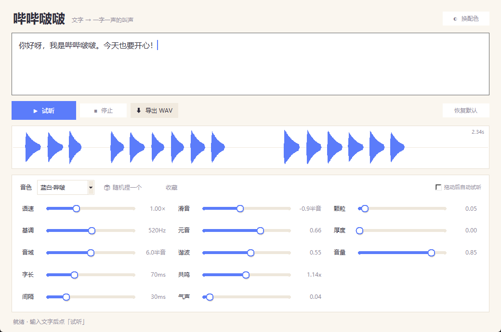

# 哔哔啵啵 · 文字转叫声

输入一段文字，点「试听」，它就变成**一字一声**的哔哔啵啵（动物森友会那种）。
音色可以换预设，也可以拖滑条自己捏；捏好了导出 WAV，拿去当提示音、桌宠配音、视频素材都行。

不用联网，不录音，不上传。



---

## 先听听

`示例/` 里放了 7 个已经生成好的 WAV，双击就能听：

| 文件 | 音色 |
| --- | --- |
| `01_蓝白_打招呼.wav` | 蓝白·哔啵（默认，偏亮偏脆） |
| `02_黑白_打招呼.wav` | 黑白·哔啵（低一点、稳一点） |
| `03_小黄鸭.wav` | 小黄鸭（音高跳得厉害，很皮） |
| `04_电子宠物.wav` | 电子宠物（方波味，复古 8-bit） |
| `05_老机器人.wav` | 老机器人（低、慢、有点闷） |
| `06_耳语小幽灵.wav` | 耳语小幽灵（气声多，像耳边说话） |
| `07_随机音色.wav` | 随机捏出来的一个音色 |

---

## 怎么用

双击 **`启动.bat`**，或者在这个文件夹里执行：

```bat
python bleep_gui.py
```

界面打开后：

1. 在最大的输入框里写文字（`Ctrl+Enter` 也能直接试听）；
2. 下面「音色」下拉选一个预设，或者点 **🎲 随机捏一个**；
3. 下面的滑条随便拖：基调、音域、语速、字长、元音、气声、音量……
4. 点 **▶ 试听**，觉得可以就 **⬇ 导出 WAV**。

觉得哪一版好听，点 **收藏** 起个名字，下次直接从下拉框里选。
程序会自动记住上次用的音色和音量。

小技巧：勾上「拖动后自动试听」，拖滑条松手就会用一小段「哔哔啵啵」试音，调起来更快。

右上角「◐ 换配色」可以在 **奶油 / 夜间 / 糖果** 三套配色之间切换，选过的会被记住。
`预览/` 里有三套配色的界面截图。

---

## 每条滑条是干嘛的

不用背这张表：**鼠标停在滑条名字（或滑条本身）上**，会弹出这条参数是调什么的、听起来会怎样。
「音色」和「拖动后自动试听」也有说明。

| 滑条 | 效果 |
| --- | --- |
| **语速** | 整句快慢。2.0× 像机关枪，0.5× 慢悠悠 |
| **基调** | 整体音高。600Hz 以上像小动物，300Hz 左右像大只的 |
| **音域** | 每个字之间音高跳动的幅度。0 = 平板，8 以上 = 活蹦乱跳 |
| **字长** | 一声持续多久。短 = 电子味，长 = 黏糊糊 |
| **间隔** | 字与字之间的空隙。太小会糊成一片 |
| **滑音** | 一声之内音高往哪滑。负数往下掉（更可爱），正数往上挑 |
| **元音** | 0 = 纯电子音；1 = 有明显的 a/e/i/o/u 口型 |
| **谐波** | 0 接近纯正弦、圆润；1 很方很复古 |
| **共鸣** | 共振峰整体高低。>1 更小只更脆，<1 更闷更厚 |
| **气声** | 噪声比例。大一点像说悄悄话 |
| **颗粒** | 软削波，加一点更「脏」、更有电子味 |
| **厚度** | 叠一个低八度，声音更厚 |
| **音量** | 播放和导出的音量 |

### 想调出视频里那种感觉

基调 `500~650`、音域 `5~7`、字长 `60~80ms`、间隔 `25~40ms`、
滑音 `-0.9` 左右、元音 `0.6`、谐波 `0.5`。默认的「蓝白·哔啵」差不多就是这个。

---

## 命令行

不想开界面、或者要批量生成的时候：

```bat
python bleep.py "你好呀，今天也要开心！" -o hello.wav
python bleep.py "嘎嘎嘎" -p 小黄鸭 -o duck.wav
python bleep.py --list
python bleep.py "随便说点什么" --random --seed 7
python bleep.py "说慢一点" --rate 1.4 -o slow.wav
```

参数：

- `-p/--preset` 音色名（见 `--list`）
- `-o/--out` 输出文件，默认 `bleep.wav`
- `--rate` 语速倍率，>1 更慢
- `--seed` 随机种子，固定后音高走向可复现
- `--random` 随机捏音色
- `--json` 顺便把音色参数打成 JSON

---

## 在自己代码里用

```python
import bleep

voice = bleep.PRESETS["蓝白·哔啵"]
voice.f0 = 600          # 想改参数直接改
u = bleep.render("你好呀", voice)
bleep.write_wav("a.wav", u.audio)
print(u.duration, len(u.events))   # 时长、每个字的起止时间
```

`u.events` 里每个字都有 `pos`（原文下标）、`t`（开始秒数）、`dur`、`f0`，
想给别的程序做「一字一声」「说到哪个字高亮哪个字」可以直接用。

---

## 文件说明

| 文件 | 作用 |
| --- | --- |
| `bleep_gui.py` | 图形界面（主程序） |
| `bleep.py` | 声音引擎，也能单独当命令行用 |
| `示例/` | 生成好的试听 WAV |
| `预览/` | 三套配色的界面截图 |
| `启动.bat` | 双击启动 |
| `设置.json` | 自动生成，记住上次的音色/音量 |
| `我的音色.json` | 点「收藏」后生成，存你自己捏的音色 |

需要 Python 3.9+ 和 numpy。这台机器上已经装好了（Python 3.11.9 + numpy 2.4.6）。

---

## 常见问题

**没声音？**
程序用 Windows 自带的 `winsound` 走系统默认输出设备。先确认默认设备没切错、没静音；
如果戴着耳机但默认设备是音箱，声音会从音箱出来。

**导出的 WAV 是什么规格？**
44100Hz、16bit、单声道。剪映/PR/QQ/微信都能直接用。

**能不能导出 MP3？**
需要额外装编码器，暂时只出 WAV；WAV 拖进剪辑软件再导出就行。

**收藏的音色存哪了？**
本文件夹的 `我的音色.json`，纯文本，可以直接改数值。

**会不会偷偷录音/联网？**
不会。程序只做「文字 → 波形」，没有任何录音和网络代码。
